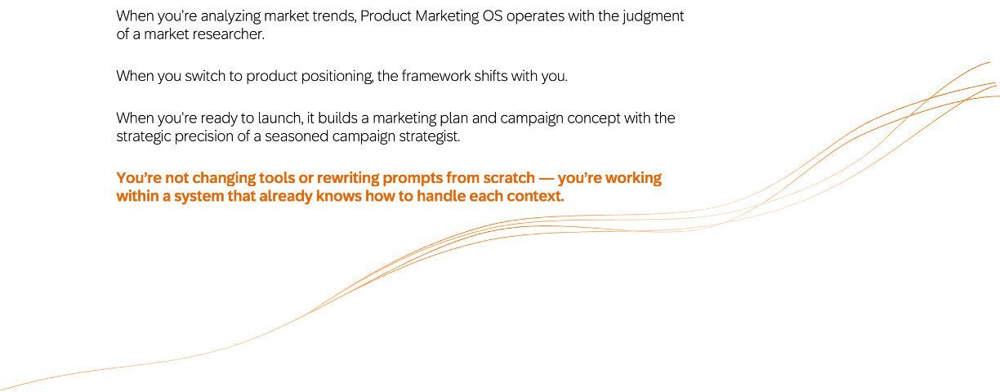
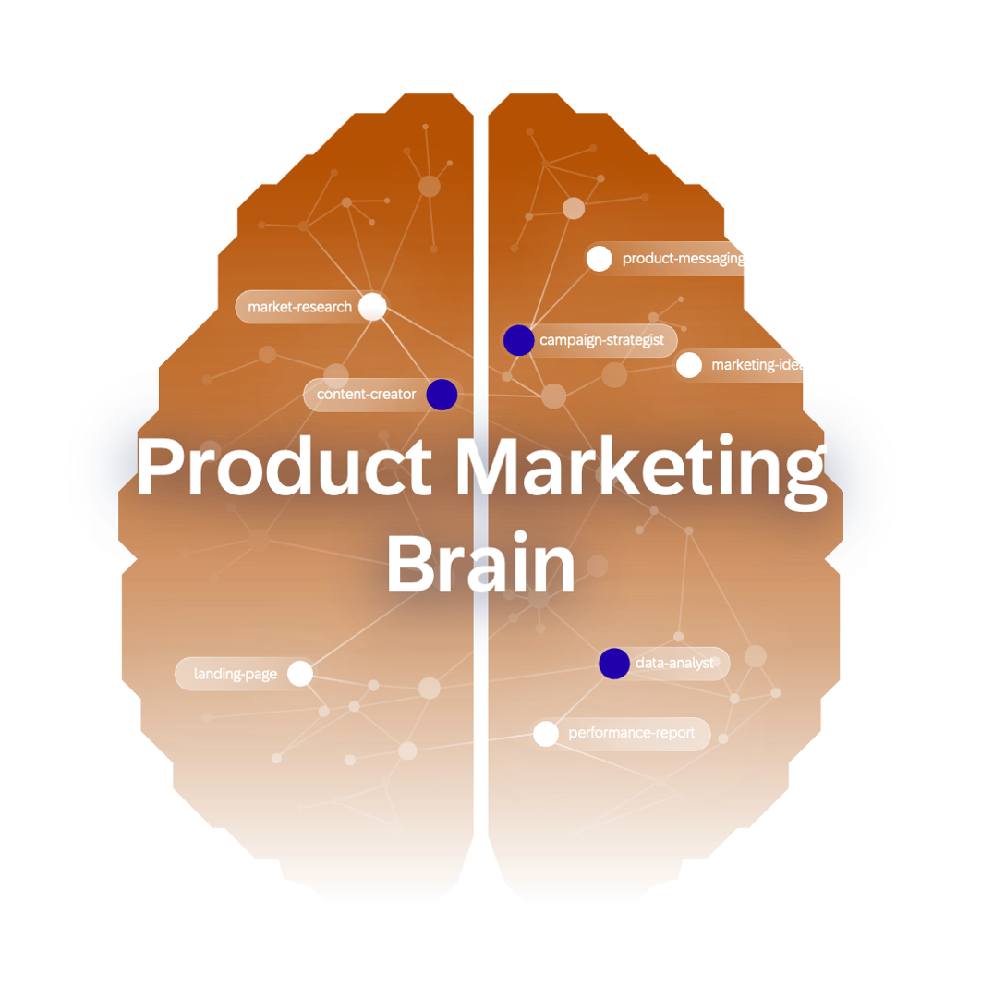
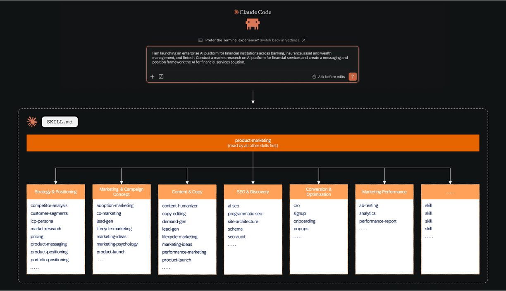
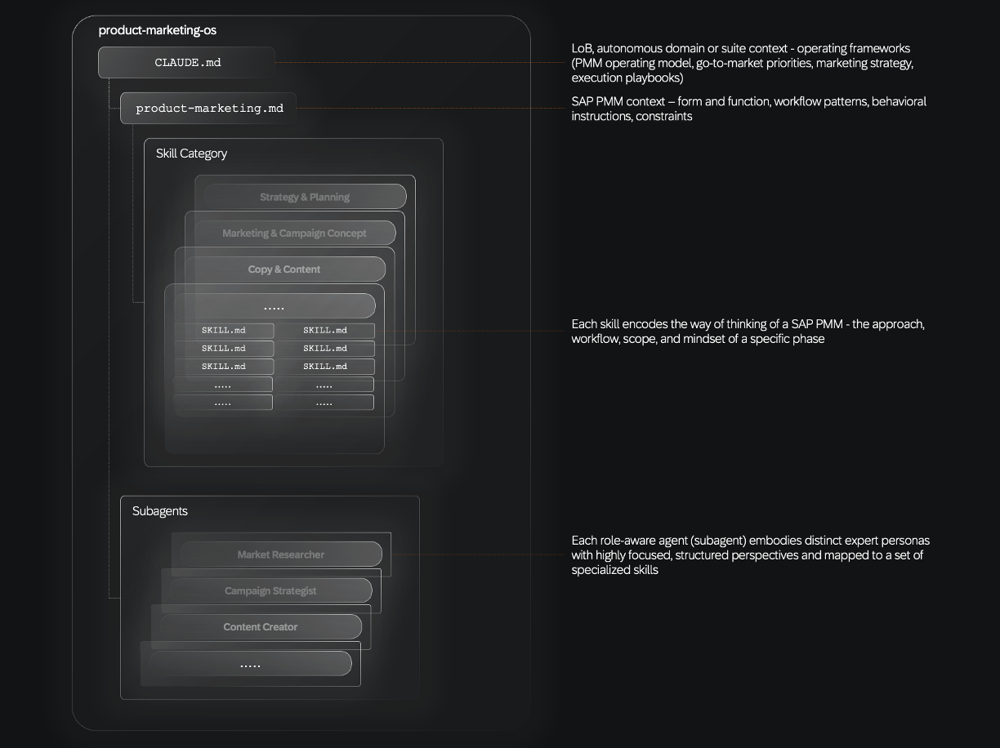

# Product Marketing OS

## Problem Statement

Product marketers often use AI prompts in their daily routines to generate marketing strategies, refine messaging and positioning frameworks, and scale the production of marketing assets and content. For every campaign, launch and event, they construct the context for new prompts from scattered inputs and tweak the prompts dozens of times to refine the outputs. These issues are not unique to one large language model (LLM) or AI assistant tool. Without more structure and context, product marketers experience "context fatigue" (having to re-write the prompt and re-feed context constantly), generic content "that sounds AI-ish", and disjointed workflows, resulting in inconsistent outputs, lack of coherence across tasks, and heavy manual oversight.

## Current State

Today, product marketing execution is largely manual and fragmented across the full campaign or launch lifecycle, relying on tools like docs, slides, spreadsheets, Microsoft Teams chats, and agency handoffs, where product marketers must individually research inputs, synthesize briefs, and translate strategy into execution under tight timelines.

While prompting through a multi-agent orchestration improves task decomposition by delegating work to specialized agents, the current approach reveals several limitations: Outputs can be generic due to agents lack grounded context, latency increases due to large context windows, and agents may misinterpret instructions or lose context as workflows become more complex.

## Solution: Product Marketing OS

Evolve the multi-agent orchestration into a structured, skill-based AI prompt built on Claude Code, designed specifically for product marketing workflows. Instead of relying on one-off prompts with general-purpose LLMs, the solution leverages a library of reusable "skills" (skill.md) and specialized subagents that encode best practices across the marketing lifecycle—from market research synthesis and messaging development to campaign strategy and creative execution.

Each skill captures proven methodologies (e.g., persona development, value proposition design, campaign ideation), enabling consistent, high-quality outputs while reducing ambiguity in prompt interpretation. Subagents are orchestrated to execute discrete tasks with clear inputs and outputs, improving accuracy, reducing context overload, and minimizing latency. This approach transforms prompting from an ad hoc activity into a structured system of execution—where context is modular, reusable, and purpose-built—resulting in more differentiated, on-brand, and scalable campaign and asset development for product marketers.

It specifically solves the following challenges:

- **Stops Context Bloat and Prompt Fatigue:** Instead of re-explaining your product positioning, target audience, MPF or brand voice in every new chat, Claude Code loads only the necessary skill file when a task is invoked. This saves massive amounts of context and keeps AI outputs relevant.
- **Automates Product Marketing Execution:** Product Marketers without coding backgrounds can trigger pre-built skills for tasks like competitive analysis, product launch campaign, copywriting, or data analysis.
- **Standardizes Messaging & Positioning Framework and Brand Guidelines:** By creating foundational SKILL.md files (e.g., product marketing brain, ideal customer profiles, or messaging frameworks, etc.), it ensures that every marketing asset generated adheres to the guidelines.

## Prompting Approach

Leveraging Skills and Subagents prompting approach is a major leap forward from "prompt engineering". Instead of writing massive 500-line system prompts to a single agent, you separate concerns: Skills act as reusable, auto-loaded "expertise", while Subagents are isolated specialists that prevent context bloat.

Skills prevent prompt bloat by keeping knowledge separate until needed. When a product marketer sends a request through prompting, the main agent reads a brief description of the available skills and loads only the relevant ones into the active context.

## How It Works: Prompting with Product Marketing Skills

Claude Code is the interactive workspace and chat interface where product marketers prompt and execute requests. It activates Product Marketing OS, where pre-built product marketing skills and specialized agents (e.g., market researcher, campaign strategist, content creator, creative designer, etc.) execute product marketing workflow according to the request using a shared context layer that retains product marketing knowledge - MPF, ICPs, brand voice, and past campaigns and launches.

Agents orchestrate the distillation of complex inputs into structured, insight-led briefs, enables rapid generation and simulation of differentiated campaign concepts and content variants, and scales execution by adapting a single master narrative into channel-specific, persona-tailored, and on-brand assets and content—all while maintaining brand consistency and visual cohesion. Instead of prompting from scratch, product marketers select skills (e.g., `/product-launch-gtm`) and trigger the pre-built skill (e.g., product launch), producing consistent, structured outputs that improve over time.

## Product Marketing Brain

Product Marketing Brain is a centralized knowledge and framework aligned to product marketing form and function context, specialized agent skills and workflow patterns. It eliminates repetitive prompting by giving Claude product marketing permanent context and specialized agents product marketing skills as describe above to handle focused, complex tasks and operates independently, gathers its results, and returns only the necessary, synthesized information to the main conversation. This ensures the main context window remains perfectly clean.

## Desired Outcome / Impact

Success is defined by transforming product marketing into a fast, scalable, and insight-driven performance team where execution is no longer a bottleneck but a competitive advantage, measured through clear improvements in speed, quality, and consistency:

- **Time saved:** Reduce briefing and marketing asset and campaign development cycles from days to hours, accelerating time-to-launch across all initiatives
- **Quality improved:** Increase strategic alignment and creative differentiation, measured by stronger audience engagement, higher-performing campaigns, and reduced reliance on templated outputs
- **Errors reduced:** Minimize misalignment and inconsistencies across messaging, channels, and audiences, leading to fewer revisions and less rework across teams and agencies
- **Measurable impact:** Track improvements through cycle time reduction, asset production speed, engagement/conversion metrics, brand consistency audits, and internal stakeholder satisfaction scores
